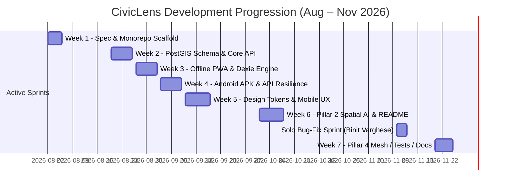

# CivicLens — Project Progression & Development Log

This document chronicles the week-by-week engineering progression of **CivicLens** from repository creation (**August 2, 2026**) through **November 25, 2026**, reconstructed from the repository's commit history (`ee4d4fc` → `d86ca04`) and the implemented codebase across `api/`, `app/`, `infra`/Docker, tests, and `docs/`.

> **Schedule Note:** Weekly milestones are aligned to active development windows, with explicit pauses during **August 7–19**, **September 18–30**, and **October 9–November 19** (aside from an **individual bug-fix sprint on November 9–12**).

---

## Timeline Overview

---

## Week 1: August 2 – August 6, 2026
**Focus:** Project Conception, EPICS Specification & Monorepo Scaffolding  
**Reference Commits:** `ee4d4fc`, `ff88ce4`, `5c83874`

- **Repository & Licensing:** Initialized the `CivicLens` repository with an MIT `LICENSE` and starter `README.md`.
- **Technical Specification:** Authored `CivicLens_Project_Plan.md`, defining the 14-week scope for a single pilot Gram Panchayat ward, hardware/network constraints (2GB RAM Android Go devices, 2G/3G dead zones, \$0/month free-tier cloud budget), and alignment with rural governance workflows.
- **Monorepo Scaffolding:**
  - **Backend (`api/`):** Set up Node.js + Express + TypeScript (`api/package.json`, `api/tsconfig.json`).
  - **Frontend (`app/`):** Set up React 19 + Vite + TypeScript + ESLint (`app/package.json`, `app/vite.config.ts`, `app/eslint.config.js`, `app/src/main.tsx`, `app/src/App.tsx`).

---

## Pause: August 7 – August 19, 2026
*CAT-1.*

---

## Week 2: August 20 – August 26, 2026
**Focus:** PostGIS Spatial Database, Core REST API & Auth Hardening  
**Reference Commits:** `ca7ef29` (backend), `f8208f2`, `f1b3eda` (auth)

- **PostGIS Database Schema (`api/src/db/schema.sql`, `seed.sql`):**
  - Enabled the `postgis` extension and modeled `users`, `villages`, `wards` (with Government LBD codes), `assets`, `issues`, `spatial_grid_summary`, and `sync_conflicts`.
  - Added `GIST` spatial indexes (`idx_assets_location`, `idx_issues_location`) and B-tree indexes for ward/type/status filtering.
  - Seeded pilot ward spatial records in `seed.sql`.
- **Stateless REST API (`api/src/`):**
  - Implemented `server.ts`, `config/db.ts`, `controllers/authController.ts`, `assetController.ts`, `issueController.ts`, `analyticsController.ts`, and `syncController.ts`.
  - Built GeoJSON endpoints (`GET /api/assets`, `GET /api/issues`), PostGIS buffer coverage-gap queries (`ST_DWithin`), and idempotent batch outbox synchronization (`POST /api/sync`).
- **Authentication & Repo Hygiene:**
  - Implemented JWT verification and role-based access control (`admin`, `panchayat_officer`, `surveyor`, `viewer`) in `api/src/middleware/auth.ts`.
  - Enforced authentication on `/api/sync` and removed tracked `api/dist/` build artifacts via `.gitignore`.

---

## Week 3: August 27 – September 2, 2026
**Focus:** Local-First PWA, Dexie.js IndexedDB & Core Field Views  
**Reference Commits:** `ca7ef29` (frontend), `f1b3eda` (offline reporting)

- **Offline Storage & PWA (`app/src/db/index.ts`, `app/public/manifest.json`):**
  - Implemented `CivicLensDexie` (`CivicLensDB` v1) with `assets`, `issues`, and `outbox` object stores, plus `StoragePersistModal.tsx` to request persistent browser storage.
  - Configured Workbox Service Worker caching for the app shell and OpenStreetMap tiles.
- **Core UI Views (`app/src/views/`):**
  - `MapView.tsx`: Interactive Leaflet map with `leaflet.markercluster`, layer toggles, and `BottomSheet.tsx` inspection.
  - `ReportIssueForm.tsx` & `MyReportsView.tsx`: Citizen grievance submission and local status tracking.
  - `VolunteerQuickAdd.tsx`: Rapid field-survey asset geotagging.
  - `AdminDashboard.tsx` & `ReportPrintView.tsx`: Ward KPIs and printable Gram Sabha summary reports.
- **Hooks, Workers & Localization:**
  - Built `useGeolocation.ts` (on-demand GPS fix), `useOfflineSync.ts` (background outbox polling), `photoWorker.ts` (off-thread JPEG compression), and initial `i18n/index.ts`.

---

## Week 4: September 3 – September 9, 2026
**Focus:** Native Android APK (Capacitor), Pilot Seeding & API Resilience  
**Reference Commits:** `1e02609`, `8727054` (backend/infra/seeding)

- **Capacitor Android Packaging (`app/android/`, `app/capacitor.config.ts`):**
  - Initialized the native Android Studio project (`org.civiclens.app`) with Gradle wrapper, splash screen, and file-provider configs.
  - Added `build-apk.bat` and `run-dev.bat` for one-click Windows APK builds and local dev startup.
- **API Resilience & Migrations (`api/src/db/migration.sql`, `.github/workflows/keep-alive.yml`):**
  - Added `migration.sql` for non-destructive schema upgrades, hardened `db.ts` connection pooling, and expanded `analyticsController.ts`.
  - Added `keep-alive.yml` GitHub Actions cron workflow to prevent free-tier Render cold starts.
- **Offline Pilot Seeding (`app/src/data/seed_pilot_ward.json`, `app/src/utils/seedLoader.ts`):**
  - Bundled realistic pilot ward assets and issues so first-time offline launches work immediately without network access, alongside `app/src/services/apiService.ts`.

---

## Week 5: September 10 – September 17, 2026
**Focus:** Design System Overhaul, Mobile GIS UX & Trilingual Support  
**Reference Commits:** `8727054` (UI), `181e116`

- **Design Tokens & CSS Architecture (`app/src/tokens.css`, `DESIGN.md`, `.impeccable/design.json`):**
  - Replaced ad-hoc inline styles across all views (`AdminDashboard`, `AuthScreen`, `MapView`, `MyReportsView`, `ReportIssueForm`, `ReportPrintView`, `VolunteerQuickAdd`) with semantic CSS custom properties and `App.css` / `index.css` classes.
- **UI & Auth Refinements:**
  - Added `AuthScreen.tsx` for login, registration, and offline demo profiles.
  - Created `CivicIcons.tsx` custom SVG civic iconography for low-literacy usability and refined `Header.tsx` and `BottomNav.tsx`.
  - Expanded `app/src/i18n/index.ts` to full trilingual support (**English**, **Hindi**, and **Marathi**).

---

## Pause: September 18 – September 30, 2026
*CAT-2*

---

## Week 6: October 1 – October 8, 2026
**Focus:** Pillar 2 Spatial Intelligence, Edge CV & Initial Documentation  
**Reference Commits:** `d86ca04` + Pillar 2 implementation (`api/src/`, `app/src/`)

- **Documentation Milestone (`d86ca04`):** Expanded `README.md` with system architecture, setup instructions, API reference, and security overview.
- **PostGIS Spatial Intelligence (`api/src/db/spatial_schema.sql`, `api/src/controllers/spatialController.ts`):**
  - Added `issue_corroborations`, `drainage_lines`, and `topographic_depressions` tables, partial functional geography GiST indexes (`idx_issues_active_location_geog`), and `fn_find_duplicate_issues`.
  - Implemented `spatialDedupService.ts` (30m radius deduplication + 1-tap community corroboration) and `waterloggingService.ts` (monsoon vulnerability scoring).
- **Edge Computer Vision & Camera Pipeline:**
  - Implemented `app/src/services/edgeVision.ts` and `api/src/services/visionService.ts` for 64-bit perceptual dHash duplicate detection, EXIF/live-capture checks, and visual severity scoring.
  - Added `cameraService.ts`, `CameraReviewModal.tsx`, `useCompassHeading.ts`, and `offlineDedup.ts` for client-side 30m duplicate checks before queueing.

---

## Pause (Part 1): October 9 – November 8, 2026
*Term End + Diwali Break*

---

## Individual Bug-Fix Sprint: November 9 – November 12, 2026
**Focus:** Solo Stabilization, Security Hardening & Edge-Case Bug Fixes *(Binit Varghese)*

- **Auth, Secrets & CORS Fixes (`api/src/config/secrets.ts`, `api/src/server.ts`):**
  - Fixed production environment secret handling so `JWT_SECRET` fails fast in production when unset while retaining a safe local-dev fallback, and added `ALLOWED_ORIGINS` parsing with Capacitor/mobile origin support.
  - Added `helmet`, `express-rate-limit` (`authLimiter` and `generalApiLimiter`), `morgan`, and `Cache-Control` headers.
- **Dexie v2 Migration & PII Decryption Fixes (`app/src/db/index.ts`):**
  - Fixed IndexedDB schema upgrade to v2 (`location_source` index on `issues`) and ensured AES-GCM-256 PII decryption gracefully handles legacy device-seed records.
- **Map State & Mobile UI Fixes (`app/src/App.tsx`, `ErrorBoundary.tsx`, `PermissionPromptCard.tsx`):**
  - Fixed Leaflet map state resets on tab switches by keeping `MapView` mounted in a hidden pane instead of unmounting.
  - Added `ErrorBoundary.tsx` and `PermissionPromptCard.tsx` to handle WebView camera/GPS permission denials cleanly.
- **Android Build Alignment (`app/android/`):**
  - Fixed `AndroidManifest.xml`, `capacitor.build.gradle`, `capacitor.settings.gradle`, and `gradle.properties` for clean Capacitor 8 builds.

---

## Pause (Part 2): November 13 – November 19, 2026
*Diwali Break*

---

## Week 7: November 20 – November 25, 2026
**Focus:** Pillar 4 Offline Mesh, PMTiles, TSP Dispatch, Docker, CI & Comprehensive Docs

- **Pillar 4 Resiliency Engines (`app/src/services/`):**
  - `pmtilesService.ts`: Offline PMTiles v3 vector basemap archive reader using IndexedDB byte-range slicing.
  - `meshSyncService.ts`: `civicmesh_v1` field-to-field P2P data-mule relay protocol with signature/tamper verification.
  - `routeOptimizationService.ts`: Offline Priority-Weighted 2-Opt TSP solver for repair worker dispatch.
- **Containerization & CI (`docker-compose.yml`, `api/Dockerfile`, `.env.example`, `.github/workflows/ci.yml`):**
  - Added one-command PostGIS + API Docker Compose stack and automated GitHub Actions CI pipeline.
- **Automated Test Suite (12 Suites, 88 Tests):**
  - **API (`api/src/__tests__/`):** 3 suites / 26 passing tests (`authAndValidation.test.ts`, `spatialIntelligence.test.ts`, `mediaAndGpsSync.test.ts`) using Vitest + `supertest`.
  - **App (`app/src/**/__tests__/`):** 9 suites / 62 passing tests covering `apiService`, `routeOptimizationService`, `pmtilesService`, `piiEncryption`, `spatialPillar2`, `meshSyncService`, `useGeolocation`, `cameraAndVision`, and `MapView`.
- **Comprehensive Documentation (`README.md`, `docs/`):**
  - Updated `README.md` with full motivation, Mermaid architecture, and quick-start guides, and generated modular documentation across `docs/` covering domain motivation, system architecture, backend API, PostGIS schema, PWA UI, offline/mesh engines, deployment/Android, and testing.
