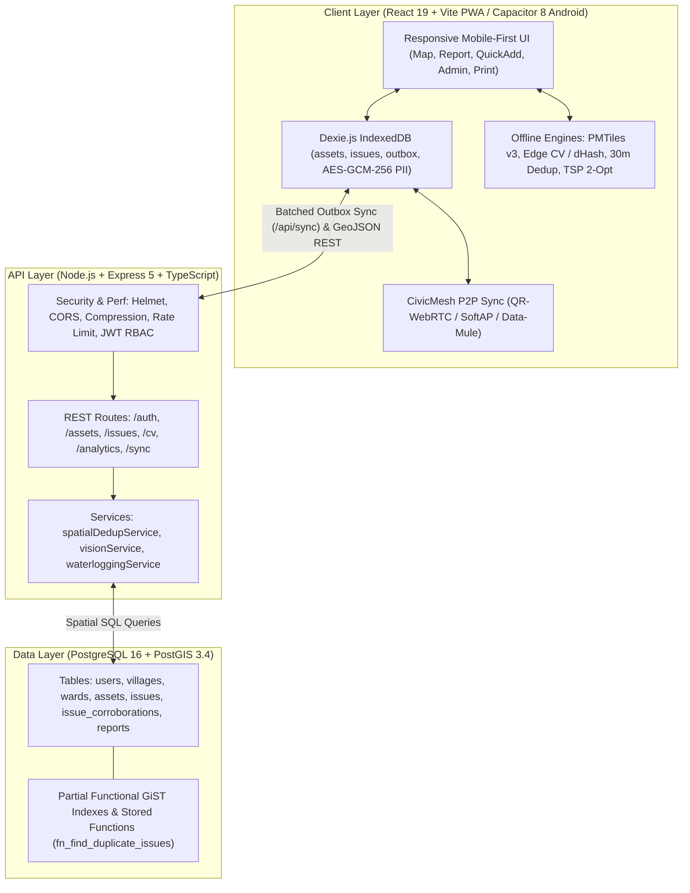

# CivicLens

**GIS-Based Rural Infrastructure & Citizen Grievance Intelligence Platform**

CivicLens is a mobile-first, local-first Geographic Information System (GIS) built for rural Gram Panchayats. It transforms scattered paper registers and word-of-mouth complaints into structured, geotagged spatial records—enabling residents, field volunteers (ASHA/Anganwadi workers, surveyors), and Panchayat officers to map infrastructure, report and corroborate grievances, and prioritize repairs on a live or offline map.

---

## Motivation & Problem Context

Rural local governance faces structural constraints that standard cloud-first web apps cannot survive:

- **The Rural Governance Gap**: Village infrastructure logs (handpumps, streetlights, public toilets, drains, Anganwadis, PHCs) often live in paper registers, while citizen complaints travel by word of mouth without location context, deduplication, or audit trails.
- **Harsh Hardware & Connectivity**: Field staff and residents predominantly use **2GB RAM Android Go** smartphones in **patchy 2G/3G or complete cellular dead zones** (forest fringes, agricultural fields, riverbanks).
- **Zero Recurring Budget ($0/month)**: Pilot Gram Panchayats cannot sustain paid SaaS or cloud bills. Every layer is engineered to run on permanent free tiers (Render, Supabase/Neon, Vercel/Netlify) with strict storage and memory guardrails.
- **National Mission Alignment**: Designed at hyper-local, single-ward resolution to support **Swachh Bharat Mission** (sanitation & drainage) and **Jal Jeevan Mission** (drinking water coverage & handpump uptime).

---

## Key Features

- **Mobile-First & Local-First (Offline by Default)**: Built with [Dexie.js](https://dexie.org/) (IndexedDB v1/v2) and a Workbox Service Worker (`vite-plugin-pwa`). All assets, issues, and forms work at zero bars of signal.
- **Outbox Background Synchronization**: Offline mutations use client-generated UUIDs (`crypto.randomUUID()`) and `client_seq_num` ordering, batch-syncing idempotently via `POST /api/sync` with conflict flagging and last-write-wins resolution.
- **PMTiles v3 Offline Vector Maps**: `pmtilesService.ts` loads an entire district vector tile archive (~28MB) from IndexedDB using zero-copy `Blob.slice()` byte-range requests and Canvas 2D rendering, avoiding 50,000-file raster cache blowups and WebGL OOM crashes.
- **Spatial Deduplication & Community Corroboration**:
  - **Backend**: Partial functional GiST index on `location::geography` (`ST_DWithin` 30m radius + `ST_Azimuth` cardinal bearing) in PostGIS.
  - **Client**: Offline 30m Haversine scan (`offlineDedup.ts`) with directional guidance and 1-tap community corroboration (`POST /api/issues/:id/corroborate`) to prevent duplicate tickets from GPS drift.
- **Edge CV & Perceptual dHash**: `edgeVision.ts` and `visionService.ts` compute 64-bit difference hashes (`dHash`, Hamming distance $\le 6$) to flag duplicate/recycled photos, while `photoWorker.ts` downscales and compresses images (JPEG) off-thread to save 2G bandwidth and database space.
- **Monsoon Vulnerability Analysis**: `waterloggingService.ts` and `GET /api/analytics/monsoon-vulnerability` score topographic depressions, drainage chokes, and soil runoff (VSI) for pre-monsoon desilting.
- **CivicMesh P2P Sync**: `meshSyncService.ts` enables dead-zone, phone-to-phone outbox relaying via QR-signaled WebRTC DataChannels, Local SoftAP, and Data-Mule store-and-forward.
- **TSP Route Optimization**: `routeOptimizationService.ts` computes priority-weighted maintenance dispatch routes offline using a 2-Opt local search heuristic (with Haversine tortuosity) and pgRouting online.
- **PostGIS Spatial Analytics & Gram Sabha Reports**: Coverage gap detection (`ST_DWithin` 500m), spatial grid hotspots, and printable ward-level PDF/print summaries (`ReportPrintView.tsx`).
- **AES-GCM-256 PII Encryption**: Resident phone numbers are encrypted on-device via Web Crypto (`db/index.ts`), and unauthenticated `GET /api/issues` requests strip PII server-side.
- **Multilingual UI & Android APK**: Trilingual **English**, **Hindi (हिंदी)**, and **Marathi (मराठी)** via `i18next`, installable as a PWA or compiled to a native Android APK via **Capacitor 8**.

---

## System Architecture



---

## Repository Structure

```text
CivicLens/
├── api/                                # Node.js + Express 5 + TypeScript Backend
│   ├── src/
│   │   ├── config/
│   │   │   ├── db.ts                   # PostgreSQL / PostGIS connection pool
│   │   │   └── secrets.ts              # JWT_SECRET & ALLOWED_ORIGINS config
│   │   ├── controllers/
│   │   │   ├── analyticsController.ts  # Summary, coverage gaps & grid hotspots
│   │   │   ├── assetController.ts      # GeoJSON asset CRUD
│   │   │   ├── authController.ts       # JWT + bcryptjs login & registration
│   │   │   ├── issueController.ts      # Grievance ingestion, PII stripping & status
│   │   │   ├── spatialController.ts    # Dedup, corroborate, CV classify & monsoon VSI
│   │   │   └── syncController.ts       # Idempotent offline outbox batch sync
│   │   ├── db/
│   │   │   ├── schema.sql              # Core PostGIS DDL schema & GiST indexes
│   │   │   ├── spatial_schema.sql      # Pillar 2 tables, partial GiST & functions
│   │   │   ├── migration.sql           # Incremental schema migrations
│   │   │   └── seed.sql                # Pilot ward spatial seed data
│   │   ├── middleware/
│   │   │   └── auth.ts                 # authenticateToken, optionalAuthenticateToken, requireRole
│   │   ├── services/
│   │   │   ├── spatialDedupService.ts  # 30m PostGIS dedup & corroboration logic
│   │   │   ├── visionService.ts        # Server-side dHash & CV classification
│   │   │   └── waterloggingService.ts  # Monsoon VSI scoring & drainage analysis
│   │   ├── __tests__/                  # Vitest + Supertest API test suites (3 suites)
│   │   └── server.ts                   # Express 5 entry point & middleware stack
│   ├── Dockerfile
│   ├── package.json
│   └── tsconfig.json
│
├── app/                                # React 19 + TypeScript + Vite PWA & Capacitor Android
│   ├── android/                        # Capacitor 8 native Android project
│   ├── src/
│   │   ├── components/                 # Header, BottomNav, BottomSheet, CameraReviewModal, CivicIcons, ErrorBoundary, PermissionPromptCard, StoragePersistModal
│   │   ├── data/seed_pilot_ward.json   # Embedded pilot ward offline seed records
│   │   ├── db/index.ts                 # Dexie.js v1/v2 schema & AES-GCM-256 PII crypto
│   │   ├── hooks/                      # useGeolocation, useOfflineSync, useCompassHeading
│   │   ├── i18n/index.ts               # English, Hindi & Marathi translations
│   │   ├── services/                   # apiService, cameraService, edgeVision, meshSyncService, offlineDedup, photoWorker, pmtilesService, routeOptimizationService
│   │   ├── utils/seedLoader.ts         # Offline IndexedDB seeder
│   │   ├── views/                      # MapView, ReportIssueForm, MyReportsView, VolunteerQuickAdd, AdminDashboard, ReportPrintView, AuthScreen
│   │   ├── App.tsx                     # Code-split tab shell & pin-pick routing
│   │   └── main.tsx                    # React DOM entry point
│   ├── capacitor.config.ts             # Capacitor 8 config (org.civiclens.app)
│   ├── vite.config.ts                  # Vite + vite-plugin-pwa (Workbox) config
│   └── package.json
│
├── docs/                               # Technical & Architecture Documentation
│   ├── README.md                       # Central documentation hub
│   ├── motivation-and-domain.md        # Problem statement, roles, constraints & goals
│   ├── architecture/                   # System overview, Pillar 4 & Unified Synthesis
│   ├── api/                            # Backend API reference
│   ├── database/                       # PostGIS schema & spatial queries
│   ├── frontend/                       # PWA, UI views, components & design tokens
│   ├── offline-and-mesh.md             # Dexie, PMTiles v3, CivicMesh, TSP & Edge CV
│   ├── deployment-and-android.md       # Docker, free-tier cloud & Android APK guide
│   ├── testing.md                      # Vitest test suites & verification guide
│   └── pillar2-advanced-gis-spatial-intelligence.md
│
├── .github/workflows/                  # CI & free-tier keep-alive cron workflows
├── docker-compose.yml                  # Local PostGIS 16-3.4 + API stack
├── build-apk.bat                       # Windows one-click Capacitor Android APK build
├── run-dev.bat                         # Windows one-click Vite dev launcher
├── CivicLens_Project_Plan.md           # 14-week EPICS specification
├── DESIGN.md                           # Survey Atlas & Civic Governance design tokens
├── .env.example                        # Environment variable template
└── LICENSE                             # MIT License
```

---

## Tech Stack

| Layer | Technology | Purpose |
|---|---|---|
| **Frontend** | React 19, Vite 8, TypeScript | Mobile-first, code-split PWA shell |
| **Offline Storage** | Dexie.js 4 (IndexedDB) + Web Crypto | Local-first store, outbox queue, AES-GCM-256 PII encryption |
| **PWA & Caching** | `vite-plugin-pwa` (Workbox) | Offline app shell & runtime caching |
| **Mapping** | Leaflet 1.9, `leaflet.markercluster`, PMTiles v3 | Interactive spatial layers & offline district vector tiles |
| **Localization** | `i18next`, `react-i18next` | English, Hindi (हिंदी), and Marathi (मराठी) UI |
| **Mobile Native** | Capacitor 8 (`@capacitor/android`, Camera, Geolocation) | Native Android APK from the same codebase |
| **Backend API** | Node.js, Express 5, Zod 4 | Thin REST API with Helmet, CORS, gzip compression, rate limiting |
| **Database** | PostgreSQL 16 + PostGIS 3.4 | Spatial indexing (partial GiST), `ST_DWithin`, `ST_Azimuth`, VSI |
| **Auth** | `jsonwebtoken`, `bcryptjs` | Stateless JWT auth & RBAC (`viewer`, `surveyor`, `panchayat_officer`, `admin`) |
| **Testing** | Vitest 5, Supertest, `happy-dom` | Unit & integration tests across API and PWA |

---

## Quick Start

### Option A: Docker Compose (Recommended for Backend + PostGIS)

1. Copy `.env.example` to `.env` if customizing secrets (or use the defaults in `docker-compose.yml` for local testing).
2. Start PostGIS and the Express API:
   ```bash
   docker compose up --build
   ```
   This initializes `postgis/postgis:16-3.4` with `api/src/db/schema.sql` and `api/src/db/seed.sql`, and starts the API on `http://localhost:4000` (`GET /api/health`).
3. In a separate terminal, start the frontend PWA:
   ```bash
   cd app
   npm install
   npm run dev
   ```
   Open `http://localhost:5173`.

### Option B: Manual Local Setup

1. **Database**: Create a PostgreSQL + PostGIS database named `civiclens` and run:
   ```sql
   \i api/src/db/schema.sql
   \i api/src/db/spatial_schema.sql
   \i api/src/db/seed.sql
   ```
2. **Backend API**:
   ```bash
   cp .env.example .env   # Configure DATABASE_URL and JWT_SECRET
   cd api
   npm install
   npm start              # Runs ts-node-dev src/server.ts on port 4000
   ```
3. **Frontend App**:
   ```bash
   cd app
   npm install
   npm run dev            # Or double-click run-dev.bat on Windows
   ```

---

## Building the Android APK

Requires Android Studio / Android SDK (`ANDROID_HOME` configured):

```bash
# Option A: Windows one-click script
build-apk.bat

# Option B: Manual Capacitor build
cd app
npm run build
npx cap sync android
cd android
./gradlew assembleDebug
```

Output APK: `app/android/app/build/outputs/apk/debug/app-debug.apk`.

---

## Testing

CivicLens uses **Vitest** across both packages:

```bash
# Backend API tests (3 suites: auth/validation, media/GPS sync, spatial intelligence)
cd api && npm test

# Frontend PWA tests (9 suites: PII encryption, geolocation, API, CV, mesh, PMTiles, TSP, Pillar 2, MapView)
cd app && npm test
```

---

## Documentation Index

Start at the **[Documentation Hub](docs/README.md)** for persona-based navigation, or jump directly to:

| Document | Description |
|---|---|
| [Motivation & Domain](docs/motivation-and-domain.md) | Rural governance problem statement, workflows, user roles, constraints & goals |
| [System Overview](docs/architecture/system-overview.md) | Client-API-PostGIS architecture, offline outbox sync & security/RBAC diagrams |
| [Backend API Reference](docs/api/backend-api-reference.md) | Express 5 middleware, REST endpoints, Zod schemas & service layer |
| [PostGIS Schema & Queries](docs/database/postgis-schema-and-queries.md) | ER diagram, tables, partial GiST indexes, triggers & stored functions |
| [PWA & UI Architecture](docs/frontend/pwa-and-ui.md) | React 19 views, components, hooks, i18n & [DESIGN.md](DESIGN.md) tokens |
| [Offline & Mesh Engines](docs/offline-and-mesh.md) | Dexie.js, AES-GCM-256 PII, PMTiles v3, CivicMesh P2P, TSP & Edge CV |
| [Deployment & Android](docs/deployment-and-android.md) | Docker Compose, `.env` config, $0 cloud hosting & Capacitor 8 APK |
| [Testing Guide](docs/testing.md) | Vitest suites, `happy-dom` & Supertest coverage |
| [Pillar 2: Spatial Intelligence](docs/pillar2-advanced-gis-spatial-intelligence.md) | Spatial deduplication, Edge CV dHash & monsoon VSI specification |
| [Pillar 4: Offline & Mesh](docs/architecture/pillar4-offline-mesh-resiliency.md) | PMTiles v3, CivicMesh v1 & TSP dispatch specification |
| [Unified Synthesis](docs/architecture/unified-spatial-offline-mesh-synthesis.md) | Cross-pillar stress-test scorecard & architectural mitigations |
| [Project Plan](CivicLens_Project_Plan.md) | 14-week EPICS specification & scope |

---

## Security & Privacy

- **On-Device PII Encryption**: Resident phone numbers are encrypted locally using **AES-GCM-256** via the Web Crypto API (`app/src/db/index.ts`) keyed from a persistent device seed (`civiclens_device_key_seed`).
- **Server-Side PII Stripping**: `GET /api/issues` uses `optionalAuthenticateToken` to strip sensitive reporter fields from unauthenticated responses.
- **Role-Based Access Control (RBAC)**: Four roles (`viewer`, `surveyor`, `panchayat_officer`, `admin`) enforced via `authenticateToken` and `requireRole(...)`. Issue status transitions require `admin` or `panchayat_officer`.
- **API Hardening**: `helmet`, restricted `cors` (`ALLOWED_ORIGINS`), `express-rate-limit` (30 req/15m on auth routes, 300 req/15m on `/api/`), and `10mb` JSON body cap.

---

## License

This project is licensed under the **MIT License** — see [LICENSE](LICENSE) for details.
