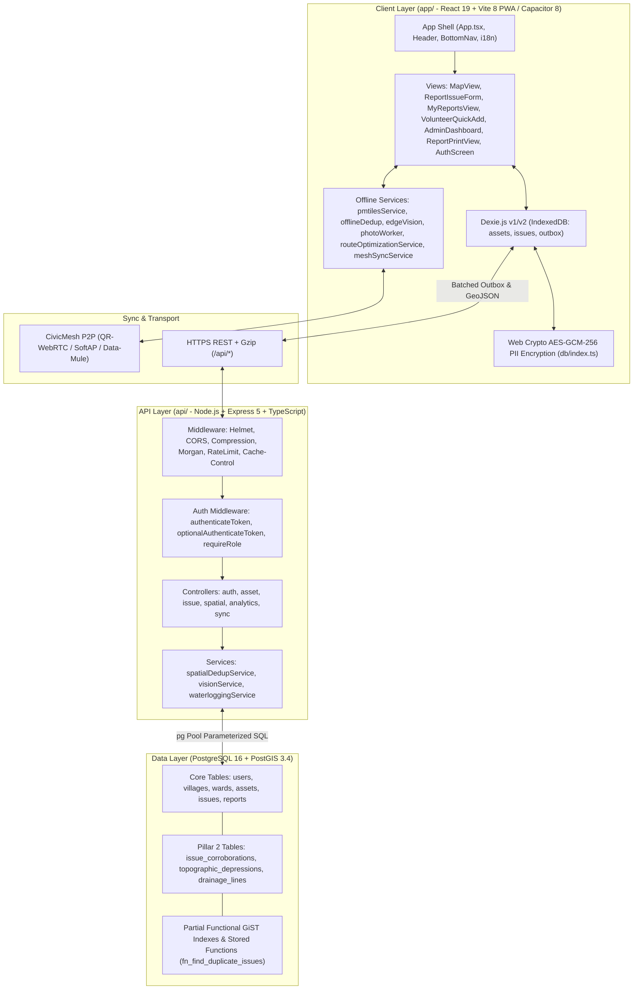
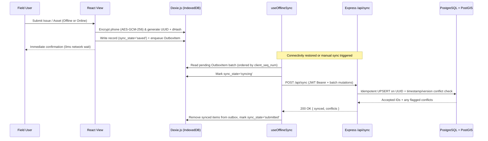
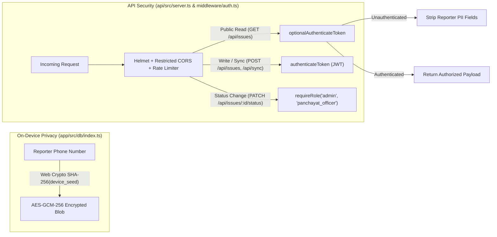

# System Architecture Overview

CivicLens is a **local-first, thin-server GIS platform**. The user's smartphone (PWA or Capacitor 8 Android APK) is the primary execution environment for reading maps, capturing geotagged media, deduplicating nearby reports, and queueing mutations. The Node.js/Express 5 API and PostgreSQL/PostGIS database act as the spatial aggregation, analytics, and multi-device synchronization hub.

---

## 1. Client–API–PostGIS Architecture

### Layer Responsibilities

- **Client Layer (`app/`)**: Renders Leaflet maps (with PMTiles v3 offline vector tiles and MarkerCluster), captures GPS + compass heading + compressed WebP photos, runs 30m local deduplication and 2-Opt TSP routing, and persists all state in Dexie.js IndexedDB.
- **API Layer (`api/`)**: Stateless Express 5 server hardened with `helmet`, `cors`, `compression`, `morgan`, and `express-rate-limit`. Validates payloads with Zod, enforces JWT RBAC, and delegates spatial math to PostGIS.
- **Data Layer (`PostgreSQL + PostGIS`)**: Stores authoritative village/ward polygons, GeoJSON-ready infrastructure assets, issues, community corroborations, and monsoon vulnerability geometry indexed with GiST.

---

## 2. Offline Outbox & Sync Flow

CivicLens avoids per-tap network requests. Every creation or update is committed locally first with a client-generated UUID (`crypto.randomUUID()`) and a monotonic `client_seq_num`, then drained in batches when connectivity returns.

### Dead-Zone Relaying (CivicMesh)
When a surveyor is in a cellular dead zone for days, `meshSyncService.ts` allows two devices to exchange signed outbox payloads over QR-signaled WebRTC DataChannels or Local SoftAP. The receiving "data mule" device stores the relayed items and uploads them to `POST /api/sync` once it reaches network coverage. See [Offline & Mesh Engines](../offline-and-mesh.md) for protocol details.

---

## 3. Security, RBAC & PII Encryption

- **Device-Side PII Protection**: Phone numbers entered in `ReportIssueForm` are encrypted with AES-GCM-256 using a per-device 32-byte random seed (`civiclens_device_key_seed` in `localStorage`), ensuring raw PII is not exposed in plaintext IndexedDB dumps.
- **Server-Side PII Stripping**: `GET /api/issues` uses `optionalAuthenticateToken` so public map viewers see issue locations, categories, and severities without exposing reporter personal identifiers.
- **Role-Based Access Control**: `authenticateToken` verifies the JWT signature against `JWT_SECRET`, and `requireRole('admin', 'panchayat_officer')` guards privileged state transitions (`PATCH /api/issues/:id/status`).
- **Transport & Abuse Controls**: `authLimiter` caps `/api/auth/login` and `/api/auth/register` at 30 requests per 15 minutes; `generalApiLimiter` caps `/api/` at 300 requests per 15 minutes; JSON payloads are capped at `10mb`.

---

## Related Documentation

- [Backend API Reference](../api/backend-api-reference.md) — Detailed endpoint contracts and middleware configuration
- [PostGIS Schema & Queries](../database/postgis-schema-and-queries.md) — Full DDL, spatial indexes, and stored functions
- [PWA & UI Architecture](../frontend/pwa-and-ui.md) — Views, components, hooks, and Workbox caching
- [Offline & Mesh Engines](../offline-and-mesh.md) — Dexie, PMTiles v3, CivicMesh, TSP, and Edge CV
