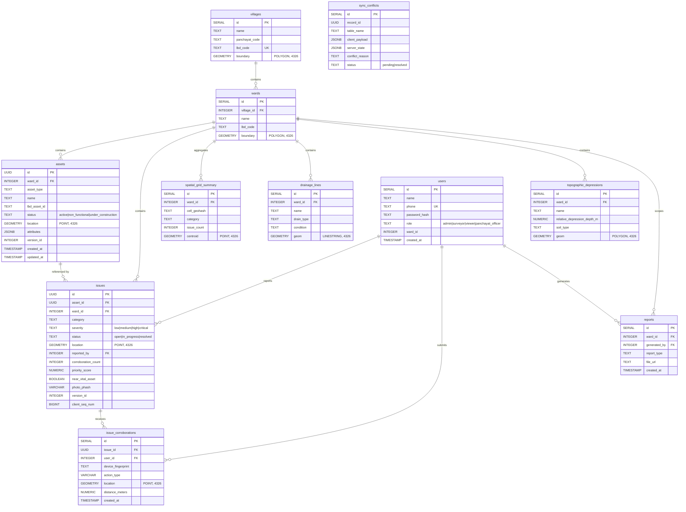

# CivicLens PostGIS Database Schema & Spatial Queries

**Database Engine:** PostgreSQL + PostGIS (`CREATE EXTENSION IF NOT EXISTS postgis;`)  
**Coordinate Reference System:** WGS 84 (`SRID 4326`) for all `GEOMETRY` columns; `::geography` casts are used for metric distance calculations (`ST_DWithin`, `ST_Distance`).  
**SQL Files:**
- [schema.sql](file:///d:/projects/CivicLens/api/src/db/schema.sql) — Primary canonical schema (tables, indexes, triggers)
- [spatial_schema.sql](file:///d:/projects/CivicLens/api/src/db/spatial_schema.sql) — Pillar 2 spatial intelligence migration (issue enhancements, corroborations, drainage, depressions, functional/partial indexes, stored functions)
- [migration.sql](file:///d:/projects/CivicLens/api/src/db/migration.sql) — Idempotent deployment migration (includes `reports` table and default ward seed)
- [seed.sql](file:///d:/projects/CivicLens/api/src/db/seed.sql) — Pilot ward seed data (Shivpur Gram Panchayat, Ward 3)

---

## 1. Entity-Relationship Diagram

---

## 2. Core & Spatial Tables

### 2.1 `users` ([schema.sql](file:///d:/projects/CivicLens/api/src/db/schema.sql#L5-L13))
| Column | Type | Constraints / Default |
| :--- | :--- | :--- |
| `id` | `SERIAL` | `PRIMARY KEY` |
| `name` | `TEXT` | `NOT NULL` |
| `phone` | `TEXT` | `UNIQUE NOT NULL` (nullable in `migration.sql`) |
| `password_hash` | `TEXT` | `NOT NULL` |
| `role` | `TEXT` | `CHECK (role IN ('admin','surveyor','viewer','panchayat_officer')) DEFAULT 'viewer'` |
| `ward_id` | `INTEGER` | — |
| `created_at` | `TIMESTAMP` | `DEFAULT now()` |

### 2.2 `villages` & `wards` ([schema.sql](file:///d:/projects/CivicLens/api/src/db/schema.sql#L16-L31))
- **`villages`**: `id SERIAL PRIMARY KEY`, `name TEXT NOT NULL`, `panchayat_code TEXT` (UNIQUE in `migration.sql`), `lbd_code TEXT UNIQUE`, `boundary GEOMETRY(POLYGON, 4326)`.
- **`wards`**: `id SERIAL PRIMARY KEY`, `village_id INTEGER REFERENCES villages(id) ON DELETE CASCADE`, `name TEXT NOT NULL`, `lbd_code TEXT`, `boundary GEOMETRY(POLYGON, 4326)`.

### 2.3 `assets` ([schema.sql](file:///d:/projects/CivicLens/api/src/db/schema.sql#L34-L49))
| Column | Type | Constraints / Default |
| :--- | :--- | :--- |
| `id` | `UUID` | `PRIMARY KEY` (`DEFAULT gen_random_uuid()` in `migration.sql`) |
| `ward_id` | `INTEGER` | `REFERENCES wards(id) ON DELETE SET NULL` |
| `asset_type` | `TEXT` | `NOT NULL CHECK (asset_type IN ('road','handpump','overhead_tank','public_toilet','school','anganwadi','phc','streetlight','drainage','ration_shop'))` |
| `name` | `TEXT` | — |
| `lbd_asset_id` | `TEXT` | — |
| `status` | `TEXT` | `DEFAULT 'active' CHECK (status IN ('active','non_functional','under_construction'))` |
| `location` | `GEOMETRY(POINT, 4326)` | `NOT NULL` |
| `attributes` | `JSONB` | `DEFAULT '{}'` |
| `version_id` | `INTEGER` | `DEFAULT 1` |
| `created_at` | `TIMESTAMP` | `DEFAULT now()` |
| `updated_at` | `TIMESTAMP` | `DEFAULT now()` |

### 2.4 `issues` ([schema.sql](file:///d:/projects/CivicLens/api/src/db/schema.sql#L55-L80) + [spatial_schema.sql](file:///d:/projects/CivicLens/api/src/db/spatial_schema.sql#L11-L19))
Base columns from `schema.sql`:
- `id UUID PRIMARY KEY` (`DEFAULT gen_random_uuid()` in `migration.sql`)
- `asset_id UUID REFERENCES assets(id) ON DELETE SET NULL`
- `ward_id INTEGER REFERENCES wards(id) ON DELETE SET NULL`
- `category TEXT NOT NULL`
- `severity TEXT CHECK (severity IN ('low','medium','high','critical')) DEFAULT 'medium'`
- `description TEXT`
- `photo_url TEXT`, `photos JSONB DEFAULT '[]'`
- `gps_accuracy_m REAL`, `heading_deg REAL`, `location_source TEXT DEFAULT 'gps'`
- `resolution_photo_url TEXT`, `resolution_photo_meta JSONB`
- `encrypted_phone TEXT`
- `location GEOMETRY(POINT, 4326) NOT NULL`
- `status TEXT DEFAULT 'open' CHECK (status IN ('open','in_progress','resolved'))`
- `reported_by INTEGER REFERENCES users(id) ON DELETE SET NULL`
- `assigned_officer TEXT`
- `version_id INTEGER DEFAULT 1`, `client_seq_num BIGINT NOT NULL DEFAULT 1`
- `server_received_at TIMESTAMP DEFAULT now()`, `date_reported TIMESTAMP DEFAULT now()`, `date_resolved TIMESTAMP`, `updated_at TIMESTAMP DEFAULT now()`

Pillar 2 columns added by `spatial_schema.sql`:
- `corroboration_count INTEGER NOT NULL DEFAULT 1`
- `photo_phash VARCHAR(64)`
- `last_corroborated_at TIMESTAMP DEFAULT now()`
- `auto_severity_score NUMERIC(5,2)`
- `ai_confidence NUMERIC(4,3)`
- `ai_detected_category TEXT`
- `priority_score NUMERIC(5,2) DEFAULT 50.00`
- `near_vital_asset BOOLEAN DEFAULT FALSE`

### 2.5 `issue_corroborations` ([spatial_schema.sql](file:///d:/projects/CivicLens/api/src/db/spatial_schema.sql#L41-L53))
| Column | Type | Constraints / Default |
| :--- | :--- | :--- |
| `id` | `SERIAL` | `PRIMARY KEY` |
| `issue_id` | `UUID` | `NOT NULL REFERENCES issues(id) ON DELETE CASCADE` |
| `user_id` | `INTEGER` | `REFERENCES users(id) ON DELETE SET NULL` |
| `device_fingerprint` | `TEXT` | PWA browser fingerprint for anonymous residents |
| `action_type` | `VARCHAR(30)` | `NOT NULL DEFAULT 'upvote' CHECK (action_type IN ('upvote','corroborate_still_present','severity_worsened','fixed_by_community'))` |
| `notes` | `TEXT` | — |
| `photo_url` | `TEXT` | — |
| `location` | `GEOMETRY(POINT, 4326)` | `NOT NULL` |
| `distance_meters` | `NUMERIC(6,2)` | — |
| `created_at` | `TIMESTAMP` | `DEFAULT now()` |

### 2.6 `drainage_lines` ([spatial_schema.sql](file:///d:/projects/CivicLens/api/src/db/spatial_schema.sql#L75-L87))
| Column | Type | Constraints / Default |
| :--- | :--- | :--- |
| `id` | `SERIAL` | `PRIMARY KEY` |
| `ward_id` | `INTEGER` | `REFERENCES wards(id) ON DELETE CASCADE` |
| `name` | `TEXT` | `NOT NULL` |
| `drain_type` | `TEXT` | `NOT NULL CHECK (drain_type IN ('pucca_concrete','kuccha_unpaved','natural_nalla','culvert'))` |
| `condition` | `TEXT` | `NOT NULL DEFAULT 'clear' CHECK (condition IN ('clear','partially_silted','severely_choked','damaged'))` |
| `width_meters` | `NUMERIC(4,2)` | `DEFAULT 1.0` |
| `depth_meters` | `NUMERIC(4,2)` | `DEFAULT 0.8` |
| `flow_direction_deg` | `NUMERIC(5,2)` | — |
| `geom` | `GEOMETRY(LINESTRING, 4326)` | `NOT NULL` |
| `created_at`, `updated_at` | `TIMESTAMP` | `DEFAULT now()` |

### 2.7 `topographic_depressions` ([spatial_schema.sql](file:///d:/projects/CivicLens/api/src/db/spatial_schema.sql#L102-L112))
| Column | Type | Constraints / Default |
| :--- | :--- | :--- |
| `id` | `SERIAL` | `PRIMARY KEY` |
| `ward_id` | `INTEGER` | `REFERENCES wards(id) ON DELETE CASCADE` |
| `name` | `TEXT` | — |
| `relative_depression_depth_m` | `NUMERIC(5,2)` | `NOT NULL DEFAULT 0.5` |
| `soil_type` | `TEXT` | `NOT NULL DEFAULT 'alluvial_loam' CHECK (soil_type IN ('clayey_black_cotton','alluvial_loam','sandy_porous','impermeable_paved'))` |
| `catchment_area_sqm` | `NUMERIC(10,2)` | — |
| `geom` | `GEOMETRY(POLYGON, 4326)` | `NOT NULL` |
| `created_at` | `TIMESTAMP` | `DEFAULT now()` |

### 2.8 Supporting Tables
- **`spatial_grid_summary`** (`schema.sql`): `id SERIAL PK`, `ward_id` (FK `wards`), `cell_geohash TEXT NOT NULL`, `category TEXT NOT NULL`, `issue_count INTEGER DEFAULT 0`, `centroid GEOMETRY(POINT, 4326)`, `last_updated TIMESTAMP DEFAULT now()`.
- **`sync_conflicts`** (`schema.sql`): `id SERIAL PK`, `record_id UUID NOT NULL`, `table_name TEXT NOT NULL`, `client_payload JSONB NOT NULL`, `server_state JSONB NOT NULL`, `conflict_reason TEXT NOT NULL`, `status TEXT DEFAULT 'pending' CHECK (status IN ('pending','resolved'))`, `created_at TIMESTAMP DEFAULT now()`.
- **`reports`** (`migration.sql`): `id SERIAL PK`, `ward_id` (FK `wards` `ON DELETE SET NULL`), `generated_by` (FK `users` `ON DELETE SET NULL`), `report_type TEXT`, `file_url TEXT`, `created_at TIMESTAMP DEFAULT now()`.

---

## 3. Indexes (GiST, Functional, Partial & Unique)

### Standard & Geometry GiST Indexes (`schema.sql`)
- `assets`: `idx_assets_location` (`GIST (location)`), `idx_assets_type` (`(asset_type)`), `idx_assets_ward_id` (`(ward_id)`).
- `issues`: `idx_issues_location` (`GIST (location)`), `idx_issues_status` (`(status)`), `idx_issues_category` (`(category)`), `idx_issues_ward_id` (`(ward_id)`), `idx_issues_ward_status` (`(ward_id, status)`), `idx_issues_reported_by` (`(reported_by)`).
- `spatial_grid_summary`: `idx_spatial_grid_ward` (`(ward_id)`).

### Functional, Partial & Anti-Fraud Indexes (`spatial_schema.sql`)
| Index Name | Table | Definition | Purpose |
| :--- | :--- | :--- | :--- |
| `idx_issues_location_geog` | `issues` | `USING GIST ((location::geography))` | Accelerates metric `ST_DWithin` / `ST_Distance` queries without full table scans. |
| `idx_issues_active_location_geog` | `issues` | `USING GIST ((location::geography)) WHERE status IN ('open', 'in_progress')` | **Partial functional GiST index:** excludes resolved historical issues from deduplication scans. |
| `idx_issues_photo_phash` | `issues` | `(photo_phash) WHERE photo_phash IS NOT NULL` | Partial B-tree index for perceptual hash duplicate image lookup. |
| `idx_issue_corroborations_issue_id` | `issue_corroborations` | `(issue_id)` | Fast lookup of corroborations per issue. |
| `idx_issue_corroborations_created_at` | `issue_corroborations` | `(created_at)` | Time-window filtering for corroborations. |
| `idx_unique_user_issue_upvote` | `issue_corroborations` | `UNIQUE (issue_id, user_id) WHERE user_id IS NOT NULL` | Enforces 1 corroboration per authenticated user per issue. |
| `idx_unique_device_daily_upvote` | `issue_corroborations` | `UNIQUE (issue_id, device_fingerprint, (date_trunc('day', created_at))) WHERE device_fingerprint IS NOT NULL AND user_id IS NULL` | Prevents same-day anonymous device spam per issue. |
| `idx_drainage_lines_geom` | `drainage_lines` | `USING GIST (geom)` | Accelerates `<->` KNN operator in monsoon lateral joins. |
| `idx_drainage_lines_geom_geog` | `drainage_lines` | `USING GIST ((geom::geography))` | Accelerates metric distance calculations to drains. |
| `idx_drainage_ward_condition` | `drainage_lines` | `(ward_id, condition)` | Ward-level drain condition filtering. |
| `idx_topographic_depressions_geom` | `topographic_depressions` | `USING GIST (geom)` | Accelerates `ST_Intersects` against `assets` and `ST_DWithin` against `issues`. |

---

## 4. Triggers & Stored Functions

### 4.1 Triggers (`schema.sql` & `migration.sql`)
- **`set_updated_at_timestamp()`** (`PL/pgSQL`): Sets `NEW.updated_at = now(); RETURN NEW;`.
- **`trg_assets_updated_at`**: `BEFORE UPDATE ON assets FOR EACH ROW EXECUTE FUNCTION set_updated_at_timestamp()`.
- **`trg_issues_updated_at`**: `BEFORE UPDATE ON issues FOR EACH ROW EXECUTE FUNCTION set_updated_at_timestamp()`.

### 4.2 Stored Functions (`spatial_schema.sql`)

#### `fn_find_duplicate_issues(p_lng, p_lat, p_category DEFAULT NULL, p_radius_meters DEFAULT 30.0, p_limit DEFAULT 5)`
- **Volatility:** `STABLE`
- **Returns:** `TABLE (id UUID, category TEXT, severity TEXT, description TEXT, photo_url TEXT, status TEXT, corroboration_count INTEGER, priority_score NUMERIC, date_reported TIMESTAMP, distance_meters NUMERIC, bearing_degrees NUMERIC, category_match_score NUMERIC, geometry JSON)`
- **Logic:**
  - Filters `issues` with `status IN ('open', 'in_progress')` and `ST_DWithin(i.location::geography, ST_SetSRID(ST_MakePoint(p_lng, p_lat), 4326)::geography, p_radius_meters)`.
  - Computes `distance_meters` rounded to 2 decimals.
  - Computes `bearing_degrees` via `DEGREES(ST_Azimuth(...))` rounded to 1 decimal, returning `NULL` if within `1.0` meter.
  - Computes `category_match_score`: `1.00` (exact case-insensitive match), `0.80` (`ILIKE '%p_category%'`), `0.50` otherwise.
  - Orders by `category_match_score DESC, distance_meters ASC` up to `p_limit`.

#### `fn_recalculate_issue_priority(p_issue_id UUID)`
- **Volatility:** `VOLATILE`
- **Returns:** `NUMERIC` (`0.0` if issue not found)
- **Logic:**
  - Reads `severity`, `corroboration_count`, `category`, and cached `near_vital_asset`.
  - Base weight: `critical` = `75.0`, `high` = `55.0`, `medium` = `35.0`, else `15.0`.
  - Upvote bonus: `LEAST(25.0, (LN(GREATEST(1, v_upvotes) + 1.0) / LN(2.0)) * 5.0)`.
  - Proximity bonus: `+15.0` if `v_near_vital_asset` is `TRUE`.
  - Updates `issues.priority_score = LEAST(100.0, ROUND(..., 2))` and `updated_at = now()`.

---

## 5. Key Spatial Queries in Application Code

- **Coverage Gap Analysis** ([analyticsController.ts](file:///d:/projects/CivicLens/api/src/controllers/analyticsController.ts#L77-L93)): Uses `NOT EXISTS` with `ST_DWithin(s.location::geography, h.location::geography, $2)` to find `school`, `anganwadi`, and `phc` assets lacking an `active` `handpump` within `distance_m`.
- **Lightweight Hotspot Grid** ([analyticsController.ts](file:///d:/projects/CivicLens/api/src/controllers/analyticsController.ts#L125-L147)): Groups unresolved issues by `ST_SnapToGrid(location, 0.005)` and computes `ST_Centroid(ST_Collect(location))` instead of `ST_ClusterKMeans`.
- **Monsoon Vulnerability CTE** ([waterloggingService.ts](file:///d:/projects/CivicLens/api/src/services/waterloggingService.ts#L127-L191)):
  1. `depression_drainage`: `LEFT JOIN LATERAL` with `ORDER BY td.geom <-> geom LIMIT 1` to find the nearest `drainage_lines` feature per depression and compute `ST_Distance(..., ::geography)`.
  2. `depression_issues`: `ST_DWithin(dd.depression_geom::geography, i.location::geography, 30.0)` filtering water/drain/flood categories.
  3. `depression_assets`: `ST_Intersects(dd.depression_geom, a.location)` aggregating affected assets with `json_agg`.

---

## 6. Seed Data & Migration Notes

- **[seed.sql](file:///d:/projects/CivicLens/api/src/db/seed.sql):** Seeds `Shivpur Gram Panchayat` (`id = 1`, `GP-248192`, `LBD-VIL-94182`), `Ward 3 (Kalyanpur)` (`id = 1`, `LBD-WRD-003`), admin user `Rajesh Kumar (Secretary)` (`phone: 9876543210`, `role: admin`), 6 infrastructure assets (`a1000000-...-0001` through `0006`: 2 handpumps, 1 school, 1 anganwadi, 1 streetlight, 1 drainage), and 3 sample issues (`b2000000-...-0001` through `0003`). Uses `ON CONFLICT (id) DO NOTHING`.
- **[migration.sql](file:///d:/projects/CivicLens/api/src/db/migration.sql):** Idempotent script (`CREATE TABLE IF NOT EXISTS`, `ALTER TABLE ... ADD COLUMN IF NOT EXISTS`) that also creates the `reports` table and seeds `Shivpur` (`GP-SHIVPUR-001`) / `Ward 3 - Kalyanpur`. Note that `spatial_grid_summary` and `sync_conflicts` are defined in `schema.sql` rather than `migration.sql`.
