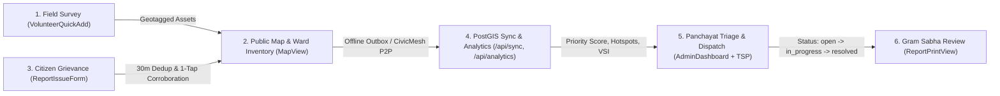

# Motivation & Domain Context

## 1. Problem Statement

Across rural India's Gram Panchayats (GPs), public infrastructure—drinking-water handpumps, overhead tanks, streetlights, paved/unpaved roads, open drainage *nallas*, public toilets, schools, Anganwadi centers, and Primary Health Centres (PHCs)—frequently suffers from outages and seasonal degradation. Yet local governance faces three chronic operational blind spots:

1. **Paper Registers & Word-of-Mouth Silos**: Infrastructure inventories sit in static paper ledgers, and citizen grievances arrive verbally or via scattered messaging apps without GPS coordinates, photos, or status tracking.
2. **Duplicate & Unprioritized Queues**: Without spatial context, multiple residents report the same broken handpump or flooded pothole at slightly different GPS coordinates (due to 5–25m civilian GPS drift), fragmenting community urgency and cluttering Panchayat queues.
3. **Lack of Spatial Planning & Pre-Monsoon Readiness**: Elected representatives and Panchayat Sachivs cannot easily see which hamlets (*tolas*) lack a functioning water source within 500m, where grievances cluster into hotspots, or which drainage chokes will trigger flooding during the June–September monsoon.

CivicLens turns village-level infrastructure and grievances into a **local-first, spatial map** aligned with national missions such as **Swachh Bharat Mission** (sanitation & drainage) and **Jal Jeevan Mission** (rural drinking water access and uptime) at hyper-local, single-ward resolution.

---

## 2. Rural Governance Workflow

CivicLens models the end-to-end lifecycle of a Gram Panchayat ward's infrastructure and citizen grievances:

1. **Asset Mapping**: Field volunteers (ASHA/Anganwadi workers, college survey teams) log public assets with one-tap GPS fixes and photos, even in cellular dead zones.
2. **Grievance Reporting & Deduplication**: Residents or volunteers report issues. Before creating a duplicate ticket, the app checks within 30 meters (offline via Dexie or online via PostGIS) and guides the user to **corroborate/upvote** an existing nearby issue.
3. **Dead-Zone Resilience**: If the device is offline, records sit in the encrypted Dexie outbox or hop between phones via **CivicMesh P2P** until a "data mule" reaches 2G/3G/Wi-Fi coverage.
4. **Prioritization & Maintenance Dispatch**: Panchayat officers review spatial hotspots, coverage gaps (e.g., schools >500m from a working water point), and monsoon Waterlogging Vulnerability (VSI), then dispatch repair staff along TSP-optimized routes.
5. **Gram Sabha Accountability**: Ward summaries and high-priority checklists are exported via `ReportPrintView` for transparent Gram Sabha budget planning.

---

## 3. User Roles & Permissions (RBAC)

CivicLens enforces four distinct roles across both the API (`api/src/middleware/auth.ts`) and the PWA UI (`app/src/App.tsx`, `app/src/views/AuthScreen.tsx`):

| Role | Typical Persona | Capabilities |
|---|---|---|
| `viewer` | Village resident / citizen | View public asset & issue map (with PII stripped), submit new grievances, corroborate/upvote nearby issues, track own reports in `MyReportsView`. |
| `surveyor` | ASHA/Anganwadi worker, field volunteer | All `viewer` capabilities plus rapid field asset inventory creation via `VolunteerQuickAdd`, CivicMesh P2P relaying, and field photo capture. |
| `panchayat_officer` | Panchayat Sachiv, Ward Officer | All `surveyor` capabilities plus updating issue lifecycle status (`open` → `in_progress` → `resolved`) via `PATCH /api/issues/:id/status`, accessing `AdminDashboard`, and printing Gram Sabha reports. |
| `admin` | System / District Administrator | Full access to all endpoints, status transitions, spatial analytics, and administrative views. |

---

## 4. Operational Constraints

Every architectural decision in CivicLens is governed by four non-negotiable field constraints:

| Constraint | Reality in Target Wards | Architectural Response |
|---|---|---|
| **Low-End Hardware** | 2GB RAM Android Go phones (MediaTek/Spreadtrum, 32GB eMMC) | Code-split React 19 views, Canvas 2D (no WebGL OOM), gated Edge ML (disabled when `deviceMemory < 4GB`), off-thread `photoWorker.ts`. |
| **Dead Zones & 2G/3G** | Up to 60% ward area without reliable signal; 40–60 kbps; prepaid data caps | Local-first Dexie.js store, 28MB single-file PMTiles v3 district maps, compressed JPEG photo payloads (`photoWorker.ts`), CivicMesh P2P store-and-forward. |
| **Zero Recurring Budget** | $0/month hosting requirement (Render + Supabase/Neon + Vercel/Netlify) | Thin stateless Express 5 API, partial functional GiST indexes (<12MB), `Cache-Control` headers, external/object photo storage rules, `.github/workflows/keep-alive.yml`. |
| **Low-Literacy & Multilingual Access** | Diverse literacy levels; Hindi, Marathi & local languages | `i18next` English/Hindi/Marathi toggle, custom `CivicIcons.tsx` visual symbols, 44px–48px tactile touch targets, high-contrast outdoor-glare-resistant palette (`DESIGN.md`). |

---

## 5. Measurable Goals (Pilot Ward Scope)

Aligned with [CivicLens_Project_Plan.md](../CivicLens_Project_Plan.md):

1. **>= 90% Asset Coverage**: Geotag visible public infrastructure (water, sanitation, lighting, roads, schools, Anganwadis, PHCs) in the pilot Gram Panchayat ward.
2. **< 3-Click Spatial Filtering**: Enable any resident or officer to filter assets and issues by type, ward, and status in under 3 taps.
3. **Objective Priority Scoring**: Rank grievances dynamically by severity, community corroborations, and proximity to vital assets rather than chronological order alone.
4. **Actionable Gram Sabha Output**: Generate printable ward-level summary reports for Panchayat budget and NREGA work planning.
5. **Zero-Install Onboarding**: Distribute the PWA via a single WhatsApp link or Panchayat noticeboard QR code, with optional native Android APK (`build-apk.bat`) for dedicated survey teams.
