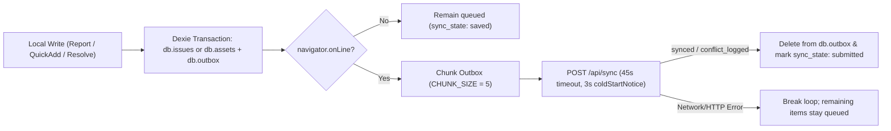

# Offline-First Storage, Sync & Field-Intelligence Engines

CivicLens is architected to operate reliably in 2G/3G dead zones on 2 GB RAM Android Go devices. All persistence, spatial deduplication, image verification, offline vector mapping, P2P relay, and repair-route dispatch run locally on-device without requiring an active internet connection.

> **Related Architecture & Design Specs:**
> - [Pillar 4: Offline-First & Field-to-Field Mesh Resiliency](architecture/pillar4-offline-mesh-resiliency.md)
> - [Pillar 2: Advanced GIS & Spatial Intelligence](pillar2-advanced-gis-spatial-intelligence.md)

---

## 1. Local Database & AES-GCM-256 PII Encryption ([`app/src/db/index.ts`](../app/src/db/index.ts))

### Dexie.js Schema (`CivicLensDB`)

`CivicLensDexie` manages three IndexedDB object stores across two schema versions:

| Table | Primary Key | Indexed Fields (v2) | Purpose |
| :--- | :--- | :--- | :--- |
| `assets` | `id` | `ward_id, asset_type, status, sync_state` | Geotagged village infrastructure (`LocalAsset`) |
| `issues` | `id` | `ward_id, category, severity, status, sync_state, client_seq_num, location_source` | Citizen/volunteer grievances (`LocalIssue`) |
| `outbox` | `++id` | `record_id, table_name, action, payload, client_seq_num, created_at` | Ordered mutation queue (`OutboxItem`) for `/api/sync` |

*Schema Evolution*: Version 1 → Version 2 added the `location_source` (`'gps' | 'manual_pin'`) index to `issues`. Each `LocalIssue` can store `photos: PhotoCaptureMeta[]` (containing `data_url`, `dhash`, `captured_at`, `latitude`, `longitude`, `accuracy_m`, `heading_deg`, `location_source`, `capture_source`, and `quality_warnings`), `resolution_photo_url`, `resolution_photo_meta`, and `encrypted_phone`.

### Dynamic AES-GCM-256 PII Encryption

Citizen phone numbers are encrypted on-device before being stored in `db.issues` or queued in `db.outbox`:

1. **Device Key Derivation**: `getOrGenerateDeviceSeed()` reads `civiclens_device_key_seed` from `localStorage` or generates 32 random bytes (`crypto.getRandomValues`) as a 64-char hex seed. `getCryptoKey()` hashes the seed with `SHA-256` and imports it as a non-extractable `AES-GCM` `CryptoKey`.
2. **Encryption (`encryptPII`)**: Generates a fresh 12-byte random IV, encrypts UTF-8 plaintext with `AES-GCM`, prepends the IV to the ciphertext, and returns Base64.
3. **Decryption (`decryptPII`)**: Splits the 12-byte IV and ciphertext; attempts decryption with `getActiveCryptoKey()`, and falls back to `getLegacyCryptoKey()` (`'civiclens-local-pii-secret-2026'`) for records created prior to per-device seed generation.

---

## 2. API Client & Outbox Sync Engine

### [`app/src/services/apiService.ts`](../app/src/services/apiService.ts)

- `API_BASE`: Reads `import.meta.env.VITE_API_BASE_URL`, defaulting to `'http://localhost:4000/api'`.
- `fetchWithAuth(endpoint, options)`: Attaches `Authorization: Bearer <civiclens_token>` and `Content-Type: application/json`, enforces a 45-second `AbortController` timeout (accommodating free-tier cold starts), and parses JSON error payloads.
- Auth helpers: `loginUser(phone, password)` (`POST /auth/login`) and `registerUser(name, phone, password, ward_id?)` (`POST /auth/register`), returning `{ token, user: UserProfile }`.

### [`app/src/hooks/useOfflineSync.ts`](../app/src/hooks/useOfflineSync.ts)

- Polls `db.outbox.count()` every 3 s and auto-triggers `triggerSync()` whenever `isOnline && outboxCount > 0 && !isSyncing`.
- Processes batches of `CHUNK_SIZE = 5` items to prevent oversized payloads and timeouts on 2G/3G links.

---

## 3. CivicMesh P2P Sync Engine ([`app/src/services/meshSyncService.ts`](../app/src/services/meshSyncService.ts))

Implements the `civicmesh_v1` protocol for field-to-field "Data Mule" synchronization in network dead zones:

1. **4-Step Anti-Entropy Reconciliation (`CivicMeshEngine`)**:
   - `createHelloMessage(knownRecordIds)` → `MeshHelloMessage` (`protocol_version: 'civicmesh_v1'`, `device_id`, `ward_id`, `known_record_ids`, `last_seq_num`).
   - `computeDeltaQuery(peerHello, localKnownIds)` → `MeshDeltaQuery` listing `missing_record_ids` present on the peer but absent locally.
   - `createBatchPayload(requestedIds, availableItems)` → `MeshBatchPayload` of `MeshSyncItem` records.
   - `ingestMeshBatch(batch, currentDatabaseRecords)` → validates each item, resolves conflicts, appends `this.localDeviceId` to `relayed_by`, increments `localSeqNum`, and returns `{ ack: MeshCommitAck, itemsToSave }`.
2. **Tamper Verification (`computeTamperHash`)**: Computes a Web Crypto `SHA-256` hex digest over `JSON.stringify({ origin, id, seq, body })`; mismatched payloads are rejected.
3. **Monotonic Status Lattice CRDT**: `STATUS_RANK` enforces `resolved (3) > in_progress (2) > open (1)` so a resolved issue can never be downgraded by a stale relay. Equal-rank ties break via Last-Write-Wins on `client_seq_num`.
4. **QR-Code Chunking & Battery Conservation**:
   - `chunkPayloadForQR(payload, maxChunkSize = 400)` and `reassembleQRChunks(chunks)` split/reassemble WebRTC SDP or compact batches for air-gapped exchange.
   - `MeshRendezvousSession(burstDurationMs = 90000)` caps P2P discovery windows to 90 s to avoid background radio drain.
5. **Data Mule PII Envelope (`encryptPIIForDataMule`)**: Encrypts citizen phone numbers with an ephemeral `AES-GCM-256` key and wraps that key with the central server's `RSA-OAEP` public key so intermediate Data Mules cannot read PII.

---

## 4. Offline Vector Tiles via PMTiles v3 ([`app/src/services/pmtilesService.ts`](../app/src/services/pmtilesService.ts))

Enables self-contained district map packages without tile servers:

- **`parsePMTilesHeader(buffer)`**: Parses the 127-byte PMTiles v3 binary header (`'PMTi'` magic bytes, `specVersion === 3`, 64-bit little-endian directory/metadata/tile offsets, zoom range, and `1e7`-scaled bounding box & center).
- **`zxyToTileId(z, x, y)`**: Maps `(z, x, y)` pyramid coordinates onto a 2D Hilbert curve index.
- **`findTileEntry(entries, targetTileId)`**: Binary search over sorted `PMTilesEntry[]` supporting `runLength` deduplication.
- **`IndexedDbPMTilesSource`**: Executes byte-range reads via zero-copy `Blob.prototype.slice(offset, offset + length)` so 30 MB+ archives never load into JS heap.
- **`TilePackageManager`**: Manages installed district packages (`TilePackageMetadata`) in IndexedDB (`CivicLens_TilePackages`, store `packages`) with `savePackage`, `getPackage`, `listPackages`, and `deletePackage`.

---

## 5. Priority-Weighted Rural TSP Dispatch ([`app/src/services/routeOptimizationService.ts`](../app/src/services/routeOptimizationService.ts))

Computes shift-feasible maintenance routes on-device in < 25 ms via `optimizeMaintenanceRoute(depot, tickets, maxShiftMinutes = 480, barriers = [])`:

1. **Rural Distance & Barrier Heuristic (`calculateRuralDistanceKm`)**: Multiplies Great-Circle Haversine distance by `RURAL_TORTUOSITY_FACTOR = 1.35` and checks `checkSegmentCrossesBarrier()` (CCW segment intersection) against `PhysicalBarrier[]` (canals/rivers), adding `detourPenaltyKm` (default `4.5` km) per crossed barrier.
2. **Multi-Factor Priority Score (`computeTicketPriorityScore`)**:
   $$\text{score} = (\text{severityWeight} + \min(\text{daysPending} \times 2,\; 30)) \times \text{lifelineMultiplier}$$
   - `SEVERITY_WEIGHTS`: `low: 5`, `medium: 12`, `high: 25`, `critical: 45`.
   - `lifelineMultiplier`: `1.25` for `water`, `handpump`, or `lighting`; `1.0` otherwise.
3. **3-Phase Solver**:
   - *Phase 1 (Construction)*: Urgency-Biased Nearest-Neighbor minimizing `distKm * 1.5 - priority * 0.15`.
   - *Phase 2 (Improvement)*: Priority-Constrained 2-Opt local search (max 50 iterations, `newDist < currentDist - 0.05`), blocking swaps where `scoreA > 40 && scoreB < 20 && j > i + 2`.
   - *Phase 3 (Shift Feasibility)*: Uses `RURAL_TRANSIT_SPEED_KMH = 18` km/h and category `ESTIMATED_REPAIR_TIMES` (20–60 min) plus the return-to-depot leg to partition `stops` vs `unservedTickets` within `maxShiftMinutes`.
4. **Online SQL Builder**: `buildPgRoutingTspQuery(wardId, depotLat, depotLon, ticketIds)` generates a PostGIS `pgr_dijkstraCostMatrix` + `pgr_tsp` query for server-side road-network routing.

---

## 6. Offline Spatial Deduplication ([`app/src/services/offlineDedup.ts`](../app/src/services/offlineDedup.ts))

- **`calculateHaversineDistance(lat1, lon1, lat2, lon2)`**: Returns surface distance in meters (rounded to 0.1 m).
- **`calculateCompassBearing(lat1, lon1, lat2, lon2)`**: Returns bearing `0–360°`, or `null` when distance `< 1.0` m (collocation guard).
- **`checkOfflineDuplicates(latitude, longitude, category?, radiusMeters = 30.0)`**: Queries `db.issues.where('status').anyOf('open', 'in_progress')` (avoiding loading resolved history into 2 GB RAM), filters within `30.0` m, and sorts same-category matches first, then shortest distance.
- **`queueOfflineCorroboration(params)`**: Increments local `corroboration_count`, sets `sync_state: 'saved'`, and enqueues an `update` (`action: 'corroborate'`) into `db.outbox`.

---

## 7. Camera-Only Capture & Edge Vision

### [`app/src/services/cameraService.ts`](../app/src/services/cameraService.ts)

Enforces **strict camera-only evidence capture** (gallery/album pickers and video are disabled):

- **`captureCameraOnlyPhoto()`**: On native (`Capacitor.isNativePlatform()`), checks/requests camera permissions and invokes `Camera.getPhoto({ source: CameraSource.Camera, resultType: CameraResultType.DataUrl, quality: 85, allowEditing: false, saveToGallery: false, correctOrientation: true })`. On Web/PWA, verifies `navigator.mediaDevices.getUserMedia` and returns `{ mode: 'webrtc', captureSource: 'camera_webrtc' }` for `CameraReviewModal`.
- **`requestWebRtcCameraStream(facingMode = 'environment')`** & **`stopMediaStream(stream)`**: Manages live `<video>` preview streams (`audio: false`).
- **Typed Errors**: `CameraPermissionError` (`CAMERA_PERMISSION_DENIED`), `CameraCancelledError` (`CAMERA_CANCELLED`), `CameraUnavailableError` (`CAMERA_UNAVAILABLE`).

### [`app/src/services/edgeVision.ts`](../app/src/services/edgeVision.ts)

Runs client-side image quality and perceptual hashing in < 20 ms:

- **`analyzePhotoQuality(img)`**: Downsamples to `160×120` on Canvas, computes ITU-R BT.601 luminance (`meanLuma < 35` → `isTooDark`) and 4-neighbor Laplacian variance (`blurScore < 75` → `isBlurry`), returning actionable `warnings`.
- **`computeCanvasDHash(img)`**: Resizes to `9×8` grayscale and compares horizontally adjacent pixels to produce a 64-bit difference hash (`16`-character hex string).
- **`computeHammingDistance(h1, h2)`**: Computes BigInt XOR bit-count between two 64-bit dHashes.
- **`processImageForCivicLens(fileOrBlob, maxDimension = 800)`**: Downscales image, extracts `dHash`, and exports WebP (`0.75`) with JPEG (`0.75`) fallback.
